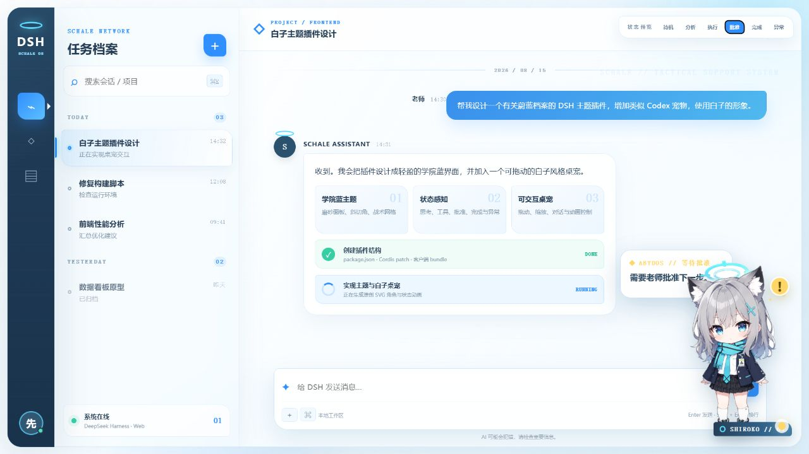

# DSH Blue Archive Shiroko Theme

[简体中文](README.md) · [English](README.en.md)

An unofficial fan-made theme plugin for the **DeepSeek Harness (`dsh`) web client**. It gives DSH a Blue Archive-inspired academy-blue interface and adds a draggable, pettable Shiroko desktop companion that can display the current assistant response.

> [!IMPORTANT]
> This project is an unofficial fan work and is not affiliated with, endorsed by, or sponsored by NEXON Games, NEXON, Yostar, Blue Archive, or OpenAI. The source code is licensed under MIT. Character names, character likenesses, and user-provided images are not covered by the MIT license. Make sure you have permission before publishing or redistributing those assets. See [ASSET_NOTICE.md](ASSET_NOTICE.md).



## Highlights

- **Blue Archive-inspired UI**
  - Academy blue and cyan accents, frosted white panels, and a tactical grid background
  - Styling for DSH sidebars, messages, composer, buttons, code blocks, and settings
- **Shiroko desktop companion**
  - Drag, resize, hide, reset position, and toggle animations
  - Autonomous idle actions such as greeting, observing, stretching, and reacting
  - Click the body or name plate to open the quick controls
- **Codex-style compact dialogue bubbles**
  - Reads the current assistant response and splits it into lightweight lines
  - Streaming sync, typewriter rendering, a blinking cursor, and post-completion rotation
  - Keeps up to 8 recent lines and prioritizes the live assistant response while generation is active
- **Petting interaction**
  - Tap the head or hold it for about 420ms
  - Includes a nod, pink glow ring, floating hearts, and a dedicated reaction line
  - Moving more than 8px cancels petting to avoid accidental activation while dragging
- **Completion chime**
  - A gentle sound synthesized with the Web Audio API after an assistant response completes
  - No official voice or sound assets are bundled; the chime can be disabled
- **Responsive settings UI**
  - Fully centered on desktop and converted to horizontal tabs on narrow screens
  - Respects `prefers-reduced-motion`

## Requirements

- A working DeepSeek Harness / `dsh` installation
- The DSH web client enabled
- A modern Chromium-based browser such as Chrome or Edge

## Installation

### Option 1: Install the GitHub Release package (recommended)

1. Download the following file from the GitHub **Releases** page:

   ```text
   dsh-blue-archive-shiroko-0.5.1.tgz
   ```

2. Run the command below and replace the path with your actual download location:

   ```powershell
   dsh plugin --profile web add "C:\path\to\dsh-blue-archive-shiroko-0.5.1.tgz"
   ```

3. Fully restart DSH Web, then press `Ctrl + F5` in the browser.

### Option 2: Install from a cloned source directory

```powershell
git clone https://github.com/mldhao/dsh-blue-archive-shiroko.git
cd dsh-blue-archive-shiroko
dsh plugin --profile web add "$PWD"
```

Restart DSH Web and refresh the page. A directory install is useful for development because local changes can be tested after a restart or refresh.

## Usage

- **Drag the character** to change its position; the position is saved automatically.
- **Tap or hold the head** to trigger the petting effect.
- **Click the body or name plate** to open or close the quick panel.
- Use **Change action** in the quick panel to trigger an autonomous interaction immediately.
- Open **Shiroko Theme** in DSH settings to control visibility, reply sync, completion sound, animation, autonomous actions, and scale.
- Use **Reset companion position** if the character was dragged outside the viewport.

Settings are stored in the current browser's `localStorage`. Autonomous interactions are enabled by default and run after roughly 12–25 seconds of idle time. They pause during tasks, while the quick panel is open, or while the page is hidden.

## Troubleshooting and removal

List installed plugins:

```powershell
dsh plugin --profile web list
```

If the page does not change after installation:

1. Confirm that the plugin appears in the `web` profile plugin list.
2. Stop and restart DSH Web completely instead of only refreshing the page.
3. Press `Ctrl + F5` to bypass the browser cache.
4. Open DSH settings and confirm the theme/plugin is enabled.
5. If an older package was installed, remove it before installing the latest release.

Removal commands may differ between DSH versions. Check the CLI available on your system:

```powershell
dsh plugin --help
dsh plugin --profile web --help
```

## Standalone preview

The repository includes a static preview that does not require DSH:

```powershell
cd dsh-blue-archive-shiroko
python -m http.server 4173
```

Open `http://127.0.0.1:4173/preview/`. The preview lets you switch companion states and drag the character.

## Development and packaging

Check JavaScript syntax:

```powershell
npm run check
```

Create the installable package:

```powershell
npm run pack:release
```

The package is written to `dist/`. If npm cannot write to the global cache, point it to a local cache first:

```powershell
$env:npm_config_cache = "$PWD\.npm-cache"
npm run pack:release
```

## Project structure

```text
dsh-blue-archive-shiroko/
├─ package.json
├─ cordis.patch.yml
├─ lib/
│  ├─ index.js
│  └─ client.js
├─ preview/
│  ├─ index.html
│  ├─ preview.css
│  └─ preview.js
├─ assets/
│  ├─ screenshot.png
│  ├─ screenshot-mobile.png
│  └─ shiroko-custom.webp
├─ README.md
├─ README.en.md
├─ CHANGELOG.md
└─ ASSET_NOTICE.md
```

## Customization

- Theme colors and DSH tokens: `TOKENS` in `lib/client.js`
- Character image: `assets/shiroko-custom.webp`
- Embedded runtime image: `PET_IMAGE` in `lib/client.js`
- Status copy and accent colors: `PHASES` in `lib/client.js`
- Autonomous actions and dialogue: `INTERACTIONS` in `lib/client.js`
- Visual rules: `STYLE_TEXT` in `lib/client.js`

After replacing the character image, also update the embedded `PET_IMAGE` in `lib/client.js`; otherwise the running plugin will continue to show the previous image.

## Known limitations

- “Codex-style” refers only to compact lines, typewriter rendering, and status feedback. This project does not copy Codex's official pet artwork, voice, or sound effects.
- Reply sync depends on DSH's current DOM structure, including `[data-chat-flow-kind="assistant-step"]` and the `aria-label` of the Stop generating button. Major DSH updates may require selector changes.
- The completion chime can be skipped when browser audio is not authorized, the page is in the background, or Web Audio is restricted by the system.
- Companion state is inferred from the page DOM without a backend service. Third-party themes or DSH markup changes may affect detection.

## Version

Current version: **0.5.1**. See [CHANGELOG.md](CHANGELOG.md) for details.

## License and notices

- Source code: MIT License, see [LICENSE](LICENSE).
- Character names, likenesses, and image assets: not covered by the MIT license, see [ASSET_NOTICE.md](ASSET_NOTICE.md).
- Intended for learning, personal customization, and fan-community use.

