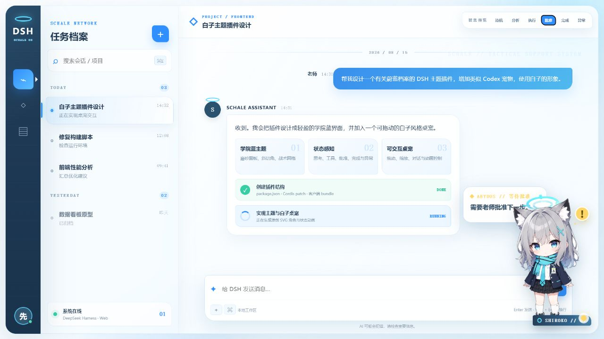

# DSH Blue Archive Shiroko Theme

[简体中文](README.md) · [English](README.en.md)

一个面向 **DeepSeek Harness（`dsh`）Web 客户端**的非官方同人主题插件。它为 DSH 提供蔚蓝档案风格的学院蓝 UI，并加入一个可拖动、可抚摸、可同步当前助手回复的白子桌宠。

> [!IMPORTANT]
> 本项目是非官方同人作品，与 NEXON Games、NEXON、Yostar、《蔚蓝档案 / Blue Archive》或 OpenAI 无隶属、授权或合作关系。代码采用 MIT 许可证；角色名称、角色形象及用户提供的图片不包含在 MIT 授权范围内。发布或再分发前请确认你拥有相关素材的使用权。详情见 [ASSET_NOTICE.md](ASSET_NOTICE.md)。



## 功能亮点

- **蔚蓝档案风格 UI**
  - 学院蓝与青色高光、白色磨砂面板、战术网格背景
  - 适配 DSH 的侧栏、消息、输入区、按钮、代码块和设置界面
- **白子桌宠**
  - 支持拖动、缩放、隐藏、位置复位和动画开关
  - 空闲时自主切换打招呼、观察、伸展和好奇等互动
  - 点击角色身体或名牌可打开快速控制面板
- **Codex 风格短句气泡**
  - 读取当前对话中的助手输出并拆分为轻量短句
  - 支持流式同步、逐字显示、闪动光标和完成后轮播
  - 最多保留最近 8 个短句，助手输出期间优先显示真实回复
- **抚摸互动**
  - 轻触或按住角色头部约 420ms 即可触发
  - 包含点头、粉色光圈、上浮爱心和专属台词
  - 拖动超过 8px 会取消抚摸，避免误触
- **完成提示音**
  - 助手回复完成时使用 Web Audio API 合成轻柔提示音
  - 不包含官方语音或官方音效，可在设置中关闭
- **响应式设置界面**
  - 桌面端完整居中显示，窄屏自动切换横向标签布局
  - 尊重 `prefers-reduced-motion`

## 环境要求

- 已安装并可正常运行的 DeepSeek Harness / `dsh`
- 已启用 DSH Web 客户端
- Chromium、Chrome、Edge 等现代浏览器

## 安装

### 方法一：安装 GitHub Release 压缩包（推荐）

1. 在 GitHub 的 **Releases** 页面下载：

   ```text
   dsh-blue-archive-shiroko-0.5.1.tgz
   ```

2. 执行以下命令，将路径替换为你的实际下载位置：

   ```powershell
   dsh plugin --profile web add "C:\path\to\dsh-blue-archive-shiroko-0.5.1.tgz"
   ```

3. 完全重启 DSH Web，然后在浏览器中按 `Ctrl + F5` 强制刷新。

### 方法二：从源码目录安装

```powershell
git clone https://github.com/mldhao/dsh-blue-archive-shiroko.git
cd dsh-blue-archive-shiroko
dsh plugin --profile web add "$PWD"
```

重新启动 DSH Web 后刷新页面。源码目录安装适合开发和调试；目录中的修改通常可在重启或刷新后直接验证。

## 使用方法

- **拖动角色**：改变桌宠位置，位置会自动保存。
- **轻触或按住头部**：触发抚摸效果。
- **点击身体或名牌**：打开或关闭快速面板。
- **换个动作**：在快速面板中立即触发一次自主互动。
- **白子主题设置**：在 DSH 设置中控制桌宠显示、对话同步、完成音效、动画、自主互动和缩放。
- **恢复位置**：桌宠离开可视区域时，在设置中点击“恢复桌宠位置”。

设置保存在当前浏览器的 `localStorage` 中。自主互动默认开启，页面空闲约 12–25 秒后触发；任务执行、菜单打开或页面隐藏时会暂停。

## 卸载与排错

查看已安装插件：

```powershell
dsh plugin --profile web list
```

如果安装后网页没有变化：

1. 确认插件出现在 `web` profile 的插件列表中。
2. 完全停止并重新启动 DSH Web，而不只是刷新网页。
3. 使用 `Ctrl + F5` 清除页面缓存。
4. 打开 DSH 设置，确认主题或插件已启用。
5. 若曾安装旧版本，先移除旧版本，再安装最新 Release。

不同 DSH 版本的移除命令可能略有差异，请运行以下命令查看当前 CLI 支持的参数：

```powershell
dsh plugin --help
dsh plugin --profile web --help
```

## 本地预览

仓库提供不依赖 DSH 的静态视觉预览：

```powershell
cd dsh-blue-archive-shiroko
python -m http.server 4173
```

浏览器访问 `http://127.0.0.1:4173/preview/`。预览页面可以切换桌宠状态并拖动角色。

## 开发与打包

检查 JavaScript 语法：

```powershell
npm run check
```

生成安装包：

```powershell
npm run pack:release
```

安装包会输出到 `dist/`。如果 npm 的全局缓存目录没有写入权限，可临时指定项目内缓存：

```powershell
$env:npm_config_cache = "$PWD\.npm-cache"
npm run pack:release
```

## 文件结构

```text
dsh-blue-archive-shiroko/
├─ package.json
├─ cordis.patch.yml
├─ lib/
│  ├─ index.js
│  └─ client.js
├─ preview/
│  ├─ index.html
│  ├─ preview.css
│  └─ preview.js
├─ assets/
│  ├─ screenshot.png
│  ├─ screenshot-mobile.png
│  └─ shiroko-custom.webp
├─ README.md
├─ README.en.md
├─ CHANGELOG.md
└─ ASSET_NOTICE.md
```

## 自定义

- 主题色与 DSH token：`lib/client.js` 中的 `TOKENS`
- 桌宠图片：`assets/shiroko-custom.webp`
- 插件内嵌图片：`lib/client.js` 中的 `PET_IMAGE`
- 状态文案与强调色：`lib/client.js` 中的 `PHASES`
- 自主互动动作与台词：`lib/client.js` 中的 `INTERACTIONS`
- 视觉样式：`lib/client.js` 中的 `STYLE_TEXT`

更换角色图片后，还需要同步更新 `lib/client.js` 中内嵌的 `PET_IMAGE`，否则运行中的插件仍会显示旧图片。

## 已知限制

- “Codex 风格”仅指短句、逐字显示与状态提示的交互方式；本项目没有复制 Codex 官方宠物图片、语音或音效。
- 对话同步依赖 DSH 当前的 DOM 结构，包括 `[data-chat-flow-kind="assistant-step"]` 和“停止生成 / Stop generating”按钮的 `aria-label`。DSH 大幅更新后可能需要调整选择器。
- 浏览器未授权音频播放、页面处于后台或系统限制 Web Audio 时，完成音效可能静默跳过。
- 桌宠状态由页面 DOM 推断，不需要后端服务，但第三方主题或 DSH 页面结构变化可能影响状态识别。

## 版本

当前版本：**0.5.1**。更新记录见 [CHANGELOG.md](CHANGELOG.md)。

## 许可证与声明

- 源代码：MIT License，见 [LICENSE](LICENSE)。
- 角色、名称与图片素材：不属于 MIT 许可范围，见 [ASSET_NOTICE.md](ASSET_NOTICE.md)。
- 本项目仅供学习、个人定制和同人交流使用。

